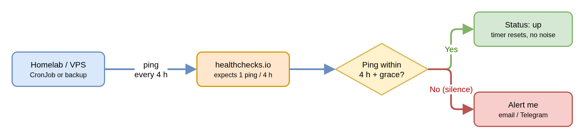

I have been running a homelab for more than 5 years now. I have experimented across bare metal, single Docker containers, VPSs, Rack servers, etc. These are the lessons learnt to run a high uptime 99.9% per year service. This is a mix of Arr Stack tips as well.

## You Should Use Declarative Tools

Compose works for a single box, but every service I ran on it eventually needed something Compose does not have: health-based restarts, proper upgrades, replicated storage, certificates, backups, production grade alerting and monitoring.

Running Kubernetes on one machine is no longer heavy. Portainer's [KubeSolo](https://github.com/portainer/kubesolo) runs a full single-node Kubernetes in under 200 MB of RAM, and Talos boots a single-node cluster from one machine config. Anywhere I would have used Compose, one of these fits.

> BuT UbUntu is FiNe why SHouLd I UsE OtHer StuFF?

Read this: [Declarative OS compared](/blog/ubuntu-is-dead-long-live-immutable-infrastructure) with AI there is no excuse why you are still using Ubuntu, Docker Compose, etc.

GitOps has saved me many times by rebuilding my homelab everytime a hardware failure occured.

## Dead Man's Switch

You have good monitoring on the same node? Great! What happens when the monitoring server itself is down?. With [healthchecks.io](https://healthchecks.io) / Instatus (recommended), each job pings a URL when it finishes, and if the ping does not arrive on schedule I get alerted. Silence becomes the alert.

## Upgrade Often, Not Once a Year

Contrary to **popular belief**, upgrading weekly or monthly is safer than upgrading once a year. Each small upgrade has a short changelog, and if something breaks I know which change did it. Skip a year and you have to jump several major versions at once, read through every deprecation and migration, and hope they all go smoothly in a single maintenance window. Renovate and Talos make the frequent path the easy one.

In my experience Critical/System components can be upgrades N-1 or once in 3-4 months. Rest can be auto upgraded based on past stability and semver.

## The 3-2-1 Backup Strategy

Repeat with my sync is NOT backup. Using rsync or scp with a cronjob is not backup. One wrong sync and everything is deleted.

You should have 3 coipies, on 2 different mediums and 1 off site.

Running on Kubernetes gave me a platform to make ALL my services achieve 3-2-1 backup. Although I run 2-2-1 backup right now, will be upgrading in near future.

1. **VolSync**: All PVC Volumes using Topolvm LVM snapshot backed up via Restic to OVHCloud S3
2. **CloudnativePG**: Production grade Postgres backups daily using WAL & Base. Upcoming 3-2-1 using [https://cloudnative-pg.io/klio/](https://cloudnative-pg.io/klio/)

## Usenet Is Dead, Long Live Torrents

Usenet costs money every month: a provider subscription, and usually an indexer on top. What you get for it keeps getting worse. DMCA takedowns remove articles quickly, so even releases only 60 to 200 days old often come down with **missing chunks**, and the download fails after you have already waited for it. Torrents cost nothing to use, and a well-seeded torrent does not lose pieces to takedowns.

## Have A Development Environment

This is one of the biggest ways to increase uptime. Most downtimes are caused by human errors or bad configs. Having continuous delivery solves this by first testing in dev then moving to prod.

## CI & Code Reviews

Have AI like Opus 5.5 review your code and long of CI checks for linting and syntax issues before pushing to "production".

## Have Proper Alertings

I personally use Discord, 