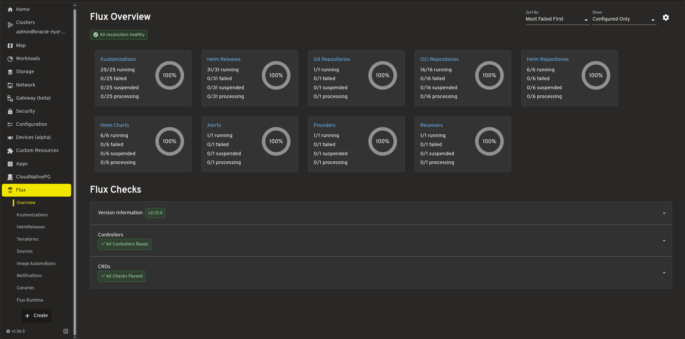

Stop using Ubuntu/Debian for servers. This blog post covers why and what you should switch to instead.

## The Problem: Not Declarative

Ubuntu/Debian are mutable OSs, you run commands on it and the system changes. **Ansible tries to solve that but in a bad way**. It tries to achieve declarative installs by making procedural playbooks. It is hard to understand at a glance what is the end state by looking at a large playbook.

There is a reason Ansible + Ubuntu is not used in Devcontainers. The result is it makes AI testing it locally in a VM harder and longer.

### Configuration Drift

There is **no guarantee** made by Ansible or Ubuntu that the playbook u executed will result in the same state after 10 years. Even if you successfully run a playbook, someone who ran SSH and changed something is not documented.

### Upgrades Are Not Atomic

`apt upgrade` changes packages one by one on a live system. If it fails halfway, because of a full disk, a dpkg prompt, a broken post-install script or a lost SSH session, you are left with a **half-upgraded** system. I once faced an outage because of a Ubuntu kernel upgrade that broke k3s, to fix that I had to run a community curl script to install the previous kernel.

### No Rollback

If a kernel update or a package upgrade breaks something, Ubuntu has no built-in "go back to how it was yesterday". You can pin versions, restore from a snapshot if you took one, or debug it live in production. None of those are a rollback.

### Increased Attack Surface

Ubuntu ships with much more packages compared to the other OSs we will look at today increasing the attack surface. Packages are also usually 2 years old in apt repo.

### Slow As Shit

Ansible runs each task over SSH, so every task pays the network round trip. From India to a VPS in the US or Germany that adds up to minutes for a playbook that should take seconds, which makes small changes painful enough that I started doing them by hand, which causes more drift.

### Mutable vs Immutable Infrastructure

Ansible changes a running server in place, so the server's state is the sum of every run that ever touched it. With immutable infrastructure you build the whole system image or config, ship it and switch to it, and rolling back means switching to the previous one. Once I had used both, I stopped wanting to go back to the mutable model.

---

## What I Want From a Server OS

* **Declarative:** the whole machine is described in files I can keep in Git, review and diff.
* **Immutable or atomic:** a change either applies fully or not at all, never halfway.
* **Rollback:** going back to the previous working state is one command or one reboot.
* **Reproducible:** building the same config twice gives the same machine.
* **Boring upgrades:** upgrading often is safe, so I actually do it.

Two operating systems do this well, in different ways: NixOS and Flatcar Container Linux (CNCF Graduated). As a bonus we will also look at single node Kubernetes (what I run).

## NixOS: The Whole Machine as Code

NixOS describes the entire system in Nix: packages, services, users, firewall rules, kernel, everything. You change the config and run `nixos-rebuild switch`. Nix builds the new system in `/nix/store`, then switches to it atomically. If the build fails, nothing on the running system changed.

Every switch creates a new **generation**. The previous ones stay in the bootloader menu, so if an upgrade breaks the machine, you reboot and pick yesterday's generation, or run `nixos-rebuild switch --rollback`.

Because the config is plain code in a flake, I build systems in CI, deploy them to many machines with tools like `deploy-rs` or Colmena, and rebuild a dead server from scratch by pointing a fresh install at the repo. There is no drift, because anything not in the config is not on the machine after the next switch (and with an impermanence setup, not even after a reboot).

The cost is the learning curve. Nix the language is unusual, the error messages can be painful, and some software assumes a normal FHS layout. For me it was worth it after the first rollback that saved an outage.

## Flatcar Linux: An OS That Only Runs Containers

Flatcar (CNCF) takes a different approach. It is a minimal OS built to run **containers and nothing else**. There is no package manager. The system is configured once at first boot.

Updates are whole OS images. Flatcar keeps two `/usr` partitions, A and B. An update is written to the inactive one, and the machine reboots into it. If the new version fails to boot, it falls back to the old partition automatically. Everything you actually run lives in containers, so the host stays small and identical across machines.

It is a great fit for container hosts. It is a poor fit if you need to install arbitrary software on the host, because you **cannot, by design**.

Preferably use this if you can delete the old VPS and create a new VPS like cattle. I prefer NixOS for single nodes because it has less downtime and is more flexible. Flatcar is truly trying to create immutable infrastructure, so you would pair it with Terraform.

## Comparison: Ubuntu vs NixOS vs Flatcar

|                         | Ubuntu Server                                          | NixOS                                                 | Flatcar Container Linux                                |
| ----------------------- | ------------------------------------------------------ | ----------------------------------------------------- | ------------------------------------------------------ |
| **System model**        | Mutable, changed in place                              | Declarative, atomic generations                       | Immutable, read-only `/usr`                            |
| **Configuration**       | Imperative commands, cloud-init, Ansible               | Nix modules in a Git repo (flakes)                    | Ignition / Butane, applied once at first boot          |
| **Package management**  | `apt` and `snap` on the live system                    | Nix, over 100,000 packages in nixpkgs                 | None on the host, everything runs in containers        |
| **Upgrades**            | Package by package, in place                           | Build the new system, then switch atomically          | Whole image written to the inactive A/B partition      |
| **Failed upgrade**      | Can leave a half-upgraded system                       | Build fails, running system untouched                 | Automatically boots the previous partition             |
| **Rollback**            | None built in, restore from backup or snapshot         | Pick any previous generation at boot, or `--rollback` | Boot the other partition                               |
| **Configuration drift** | High, anything can change at any time                  | None, the config defines the whole system             | Very low, the host is minimal and read-only            |
| **Reproducibility**     | Low                                                    | High, pinned inputs in `flake.lock`                   | High, identical images on every machine                |
| **Release model**       | LTS every two years, interim releases every six months | Stable twice a year, plus rolling `unstable`          | Stable, beta and alpha channels with frequent releases |
| **Automatic updates**   | `unattended-upgrades` (security patches)               | `system.autoUpgrade` from your flake                  | Built-in update engine with reboot coordination        |
| **AI Testing**          | Difficult                                              | Yes                                                   | Yes                                                    |
| **Best for**            | Desktops, learning Linux, vendor-supported software    | Any server, workstations, homelabs, CI builders       | Container hosts and Kubernetes nodes                   |
| **Learning curve**      | Low                                                    | High                                                  | Medium                                                 |

---

## You Should Run Kubernetes!

Most people call Kubernetes overkill for a homelab. For me it removed more work than it added. The sections below explain why.

Even if you have one node, you should!

> Kubernetes is only required for scaling

This is a myth.

### 1. A Production Ecosystem for Free

The tools companies pay for (FluxCD, Victoria Metrics, RenovateBot) are open source and install the same way at home as at work. What I learn in the homelab carries straight over to my job, and the reverse is true too.

You build the cluster once then you can run any workload: Stateless, Stateful, Serverless etc.

If you have highly available cluster even better, you have a base to run HA Postgres, storage, all in one.

### 2. Production Grade Upgrades & Rollback

Renovate watches every Helm chart and image tag in the repo and opens a PR when a new version ships. I review the changelog, merge, and FluxCD rolls it out.

With an OS like **Talos**, you don't need to worry about security, configuration drift or OS upgrades. It provides the entire OS & Kubernetes upgrade and rollback management.

### 3. Better Management Tooling

Headlamp gives me a proper UI for the whole cluster: logs, events, resource usage and a shell into any pod, all in one place. With Docker on a single host I had to either rely on paid software like Portainer or community projects like Coolify. I get the confidence of CNCF backed projects with this.

### 4. GitOps

This is the only way to get proper GitOps, no other stack comes close to this level of quality.

### 5. Mature Secrets Management

Secrets live in the same repo, encrypted with SOPS, and are only decrypted inside the cluster. No `.env` files copied around by hand, and no plaintext passwords in Git history. You are free to use any Secrets Manager via External Secrets Operator.

## Which One I Use

* **NixOS** for anything that is not a Kubernetes node: VPSs, home servers, build machines, my own workstation. One flake describes all of them.
* **Flatcar** (or Talos) when the machine only exists to run containers or Kubernetes, and I want the host to be as small and boring as possible.
* **Ubuntu** only when a vendor supports nothing else.

